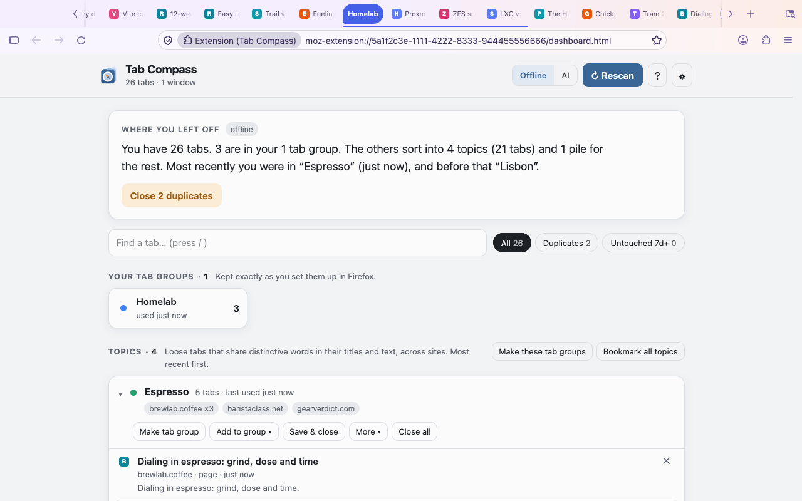
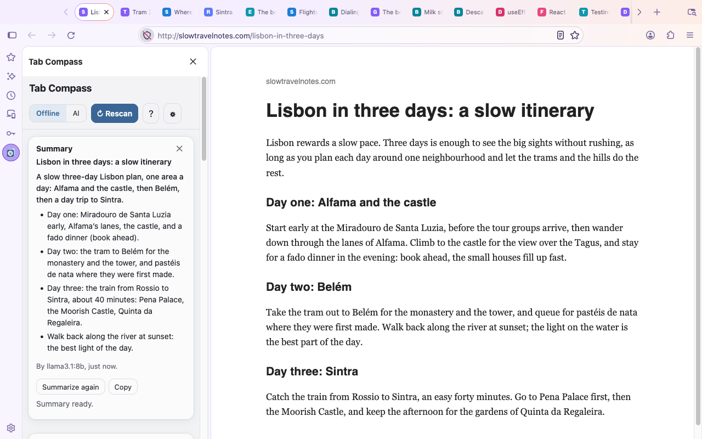

# Tab Compass

A browser extension for people who keep far too many tabs open and lose track of what they were doing.

- **Where you left off**: a few plain sentences about what you were in most recently, and what came before.
- **Topics**: loose tabs about the same thing, grouped across sites; everything else in piles by site or by type.
- **Easy wins**: one click to close duplicates, blank tabs and old searches, or to save and close tabs you haven't touched in a week.
- **Your tab groups, managed**: move tabs between groups, merge, rename, recolor, collapse or ungroup them, all with Undo.
- **Save & close, like OneTab**: keep the links, close the tabs, reopen them one at a time or all at once.
- **Snooze**: close a tab or a group until tonight, tomorrow morning, the weekend or any time you pick.
- **Tidy up by itself**, if you turn it on: tabs you haven't looked at in a week are saved & closed, a list per topic.
- **Duplicate tabs** pointed out as you open them, and **backups of your open tabs** in case the browser loses them.
- **Works offline.** Optional AI groups your tabs by what you were doing, or summarizes a page, with your own key or a model on your own computer. Nothing is sent without asking first.

## Get it

- **Firefox**: [addons.mozilla.org](https://addons.mozilla.org/firefox/addon/tab-compass-organizer/)
- **Chrome** and **Microsoft Edge**: coming soon

## Privacy

No servers, no accounts, no analytics, no ads; the developer never receives any of your data.
[The privacy policy](https://yiorgos-p.github.io/tab-compass/privacy/) says what Tab Compass reads, keeps and, only
for the optional AI features, sends.

## Help and feedback

[Open an issue](https://github.com/yiorgos-p/tab-compass/issues/new/choose) for a bug or an idea.

## Source code

Not published here yet.

Copyright © 2026 yiorgos-p. All rights reserved.
